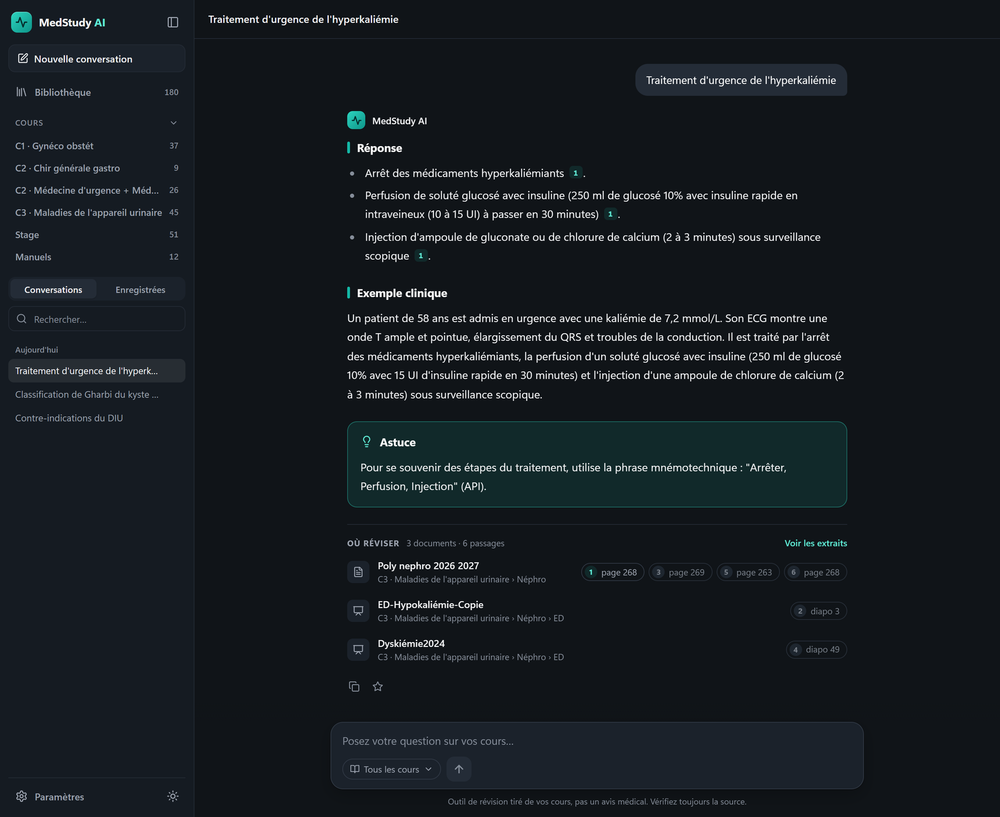
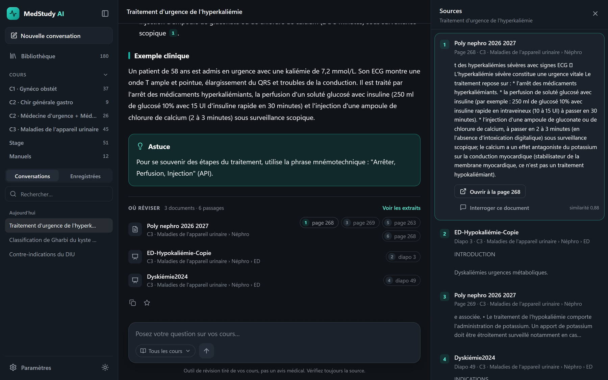
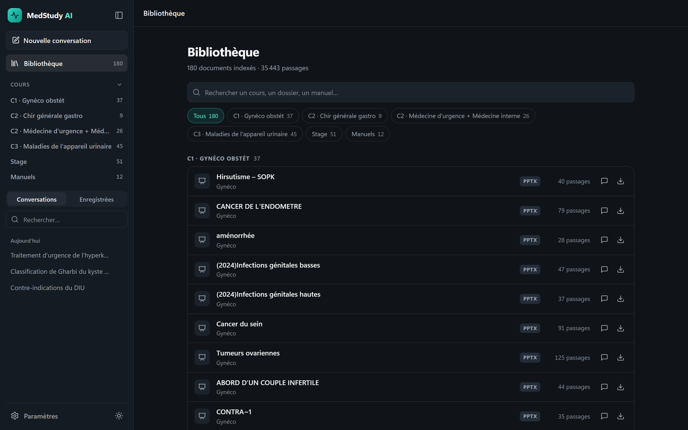
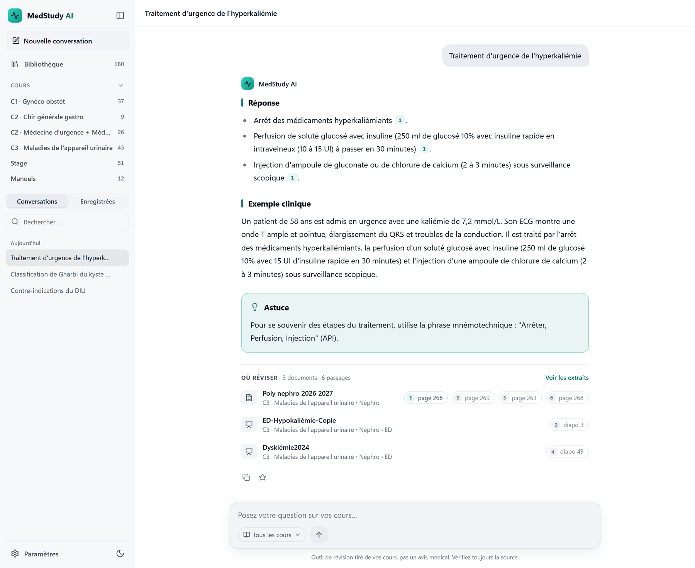
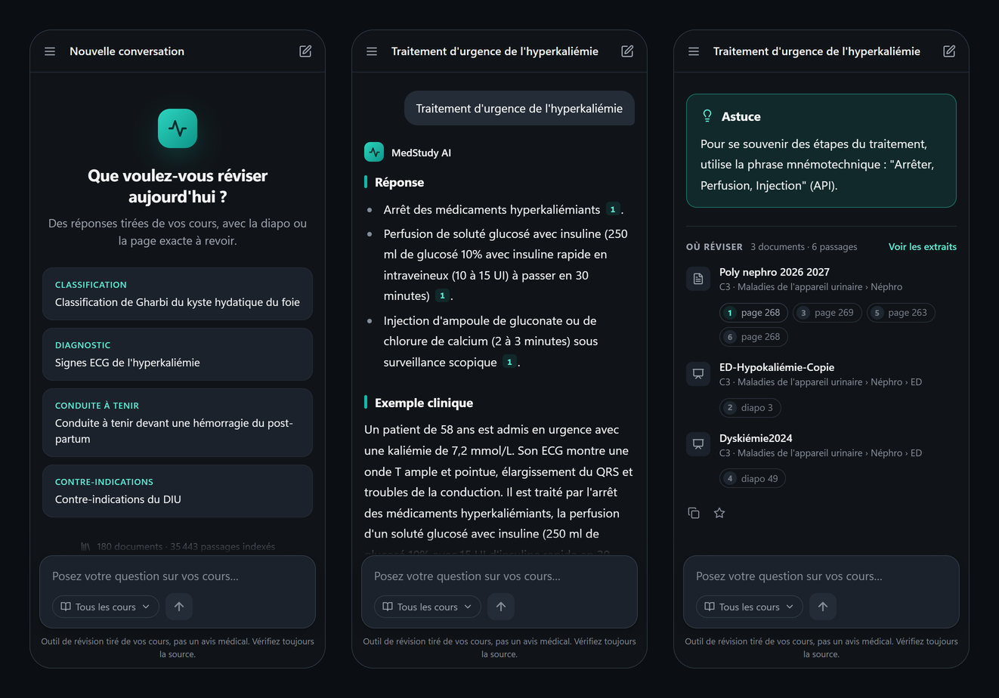
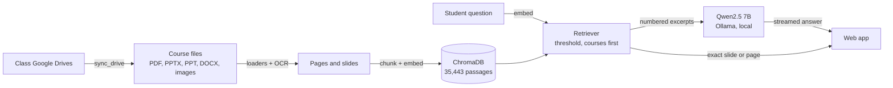

<p align="center">
  
</p>

<h1 align="center">MedStudy AI</h1>

<p align="center">
  <b>Revise from your own courses.</b> Ask a question, get an answer drawn from the faculty's
  slides and polycopiés,<br>with the exact slide or page to go back to.
</p>

<p align="center">
  <a href="https://github.com/Med00amine/Rag-project/actions/workflows/ci.yml"></a>
  
  
  
  
</p>

<p align="center">
  
</p>

> **Outil de révision bénévole, pas un avis médical.** Les réponses viennent des cours de la
> faculté, et la diapo ou la page citée fait toujours foi.

Every year the class drives fill up with lecture slides, polycopiés, internship handouts,
scanned notes, textbooks and previous years' material: thousands of files that nobody can
search. MedStudy AI indexes all of it, every format and the scans included, and answers like
a classmate who has read everything: short, structured, and sourced down to the slide.
It was first built for a DCEM2 class and runs entirely on free, open models on one PC.

**Stack:** FastAPI · multilingual-e5 embeddings · ChromaDB · EasyOCR · Ollama (Qwen2.5 7B) ·
vanilla JavaScript · Docker · Nginx · GitHub Actions

## Guide pour les étudiants

**Poser une question.** Écris comme à un camarade de promo : « Traitement d'urgence de
l'hyperkaliémie », « Contre-indications du DIU », « Classification de Gharbi du kyste
hydatique ». Une question précise donne une meilleure réponse qu'un mot isolé, et les
questions de suivi (« et chez la femme enceinte ? ») gardent le contexte.

**Lire la réponse.**

| Partie | Ce que tu y trouves |
|---|---|
| **Réponse** | l'essentiel en listes courtes, chaque fait suivi du numéro de sa source |
| **Exemple clinique** | un cas court, construit uniquement avec les faits du cours |
| **Astuce** | un moyen mnémotechnique ou un piège classique aux examens |
| **Où réviser** | les cours utilisés, regroupés par cours, avec la diapo ou la page exacte |

**Vérifier la source.** Clique sur un numéro : le passage exact s'ouvre à droite, avec le
chemin du cours et un bouton **« Ouvrir à la page N »** qui ouvre le polycopié à la bonne
page. Les diapos, elles, se téléchargent.

<p align="center">
  
</p>

**Réviser un cours précis.** La **Bibliothèque** liste tous les documents, filtrés par cours
(*C1 · Gynéco obstét*, *C3 · Maladies de l'appareil urinaire*, *Stage*, *Manuels*…).
« Interroger ce document », ou le sélecteur sous la zone de question, limite les réponses à
un seul document.

**Garder ses réponses.** L'étoile enregistre une réponse. Les conversations et les réponses
enregistrées restent dans ton navigateur : rien n'est conservé sur le serveur.

**À savoir.**
- Le modèle (Qwen2.5 7B, gratuit et local) peut se tromper : mélanger deux diapos proches, ou
  ajouter dans l'exemple clinique un détail absent du cours, comme une dose. Vérifie toujours
  la source citée avant d'apprendre un chiffre.
- Les tableaux en image sont lus par OCR et peuvent être mal transcrits : ouvre la diapo.
- Si les cours ne couvrent pas la question, l'assistant le dit au lieu d'inventer.
- C'est un outil de révision : jamais pour décider de la prise en charge d'un vrai patient.

## Screenshots

| Library, filtered by course | Light theme |
|---|---|
|  |  |

<p align="center">
  
</p>

## Built for large course collections

The current index holds the 2026–27 material from three class drives:

| | |
|---|---|
| Documents | 180: lectures, polycopiés, internship handouts and 12 textbooks |
| Passages | 35,443, each tied to its lecture, folder and slide or page |
| Index on disk | 281 MB |
| Search | ~30 ms per question, on CPU |

What makes that work, and keeps it working as the previous years' drives (4,000+ files) come in:

- **Every format in the drives.** PDF, PPTX, DOCX, images, and legacy binary `.ppt` read
  straight from the PowerPoint record stream, without LibreOffice.
- **Scans included.** About one file in five had no extractable text. Pages and slides with
  little text are OCR'd on the GPU (EasyOCR, French) and cached by image hash, so re-indexing
  never redoes OCR.
- **Straight from Google Drive.** `sync_drive` walks public folders, follows shortcuts,
  exports Google Docs and Slides, retries when rate-limited, and skips files whose owner
  disabled downloads.
- **Each file once.** A lecture shared in several folders is indexed once (content hash), and
  re-running the indexer only processes new files.
- **No noise.** Outline and closing slides (*Plan*, *Merci pour votre attention*) are dropped.
- **Courses first.** Textbooks hold three times more text than the slides; a small ranking
  penalty keeps the faculty's own slides first, and textbooks fill the gaps.
- **Measured, not guessed.** A French question set, mapped to the lectures that answer it,
  chose the embedding model and calibrates the "not in the courses" threshold
  ([below](#retrieval-evaluation)).

### Adding a new year or drive

```bash
python -m scripts.sync_drive <drive-folder-url> --exclude .mp4   # download; re-runs skip existing files
python -m scripts.ingest data/raw/drive                           # indexes only the new files
```

- `--exclude Books` leaves the textbooks out; `--no-ocr` gives a fast first pass without scans.
- OCR and the chat model don't fit together on an 8 GB GPU: run `ollama stop qwen2.5:7b`
  before indexing, then restart the app so it loads the new index.

## How it works



A question is embedded with multilingual-e5, and the closest passages above a similarity
threshold are retrieved, course slides ranked before textbooks. Qwen2.5 7B writes the answer
from those numbered excerpts only, citing them. The app builds *Où réviser* from the passages'
metadata, so slide and page numbers never come from the model.

- **Streaming.** Answers arrive as NDJSON: the sources first, then the text as it is written.
- **Safe rendering.** The web app escapes all model and course text before its Markdown
  renderer runs, and turns `[n]` into a badge only when passage *n* was really retrieved.
- **Guarded files.** Adding or removing documents needs an admin token. Only indexed files
  inside the library folders can be opened, and textbooks are quoted, never handed out whole.
- **No frontend build.** Plain ES modules served by FastAPI, with inline Lucide icons.

## Run it

Requirements: Python 3.11+, [Ollama](https://ollama.com/download), and an NVIDIA GPU for OCR
while indexing. Answers also run on CPU, slowly ([see below](#host-it)).

```bash
ollama pull qwen2.5:7b
pip install -e ".[dev,sync,ocr]"
cp .env.example .env

python -m scripts.sync_drive <drive-folder-url> [...] --exclude .mp4   # download the courses
python -m scripts.ingest data/raw/drive                                 # index, OCR included
make run                                                                # http://localhost:8000
```

To add and remove documents from the web app, set `ADMIN_TOKEN` in `.env` and enter the same
value in *Paramètres*.

## Host it

Measured on the full index (Intel i5-12400F, RTX 4060):

| Part | Needs |
|---|---|
| Web app and search | ~2 GB RAM, CPU only |
| Index | 0.3 GB disk |
| Course files, for « Ouvrir à la page » | ~1 GB disk without the textbooks |
| Qwen2.5 7B (Ollama) | ~5 GB of RAM or VRAM, 4.4 GB disk |

The model sets the cost. An answer takes **5–15 s on the GPU** and **~80 s on the 6-core
CPU**, longer on the shared cores of a typical VPS. From cheapest to fastest:

- **Small VPS** (2 vCPU, 4 GB RAM) for the site, with the model on a GPU machine reached over
  a private network, or `LLM_PROVIDER=claude` (paid per answer).
- **CPU VPS** (8 vCPU, 16 GB RAM, 40–80 GB SSD): everything on one server, answers in minutes.
- **GPU server** (8 GB VRAM or more, 16 GB RAM): everything on one server, answers in seconds.

Index on your own GPU machine and copy `data/chroma` to the server, which then needs no OCR.
`docker-compose.prod.yml` runs the API, Ollama and Nginx; on a GPU server, give its Ollama
service access to the GPU.

## Retrieval evaluation

26 student-style questions with the lectures that answer them, plus off-topic questions
(`data/evaluation/medical_retrieval_eval.json`). Embedding models compared on the first index
(~10,500 passages):

| Embedding model | hit@1 | hit@5 | MRR |
|---|---|---|---|
| all-MiniLM-L6-v2 (English baseline) | 0.65 | 0.81 | 0.73 |
| paraphrase-multilingual-MiniLM-L12-v2 | 0.50 | 0.81 | 0.60 |
| multilingual-e5-small | 0.85 | 0.96 | 0.90 |
| **multilingual-e5-base** (used) | **0.88** | **1.00** | **0.91** |

On the full index (35,443 passages, textbooks included, courses ranked first), e5-base keeps
hit@1 0.88, hit@5 0.96 and MRR 0.90. It was also the only model whose weakest course question
still scored above every off-topic question, which is what lets `MIN_SCORE` answer "not in the
courses" reliably.

Reproduce with `python -m scripts.evaluate_retrieval intfloat/multilingual-e5-base --penalties 0 0.02`.

## API

| Method | Path              | Description                                              |
|--------|-------------------|----------------------------------------------------------|
| GET    | `/`               | Web app                                                  |
| POST   | `/chat`           | Streamed answer (NDJSON: `sources`, `token`…, `done`)    |
| POST   | `/query`          | Same answer as one JSON response                         |
| GET    | `/documents`      | Indexed documents, with passage counts                   |
| GET    | `/documents/file` | Original course file (PDFs open inline, at `#page=N`)    |
| POST   | `/documents`      | Add a document (requires `X-Admin-Token`)                |
| DELETE | `/documents`      | Remove a document from the index (requires the token)    |
| GET    | `/health/ready`   | Readiness, with the number of indexed passages           |

## Project layout

```
app/
  api/           routes, dependencies, error handlers, middleware
  ingestion/     loaders (PDF, PPTX, PPT, DOCX, images), OCR, cleaning, chunking
  embeddings/    sentence-transformers wrapper (query/passage prefixes)
  repositories/  ChromaDB vector store
  retrieval/     retriever (threshold, courses first)
  generation/    prompt, LLM clients (Ollama, Claude)
  services/      ingestion and RAG orchestration
  static/        web app: ES modules (chat, library, Markdown renderer), CSS
scripts/         sync_drive, ingest, evaluate_retrieval
tests/           API, ingestion, retrieval and streaming tests (fake embedder and LLM)
  js/            frontend tests (node --test)
assets/          logo and README screenshots
deploy/          Nginx config
```

## Tests

```bash
make test                     # Python tests; `pytest -m "not slow"` skips the real embedding model
make test-ui                  # frontend: Markdown rendering and escaping, course names (Node 22)
make lint
```

CI runs the linter, both test suites and the Docker build on every pull request.

## Course material

Course files stay on your machine (`data/` is git-ignored) and belong to their authors. The
app quotes textbooks in its answers but never serves them whole; before sharing it beyond
your class, index without them: `python -m scripts.ingest data/raw/drive --exclude Books`.
